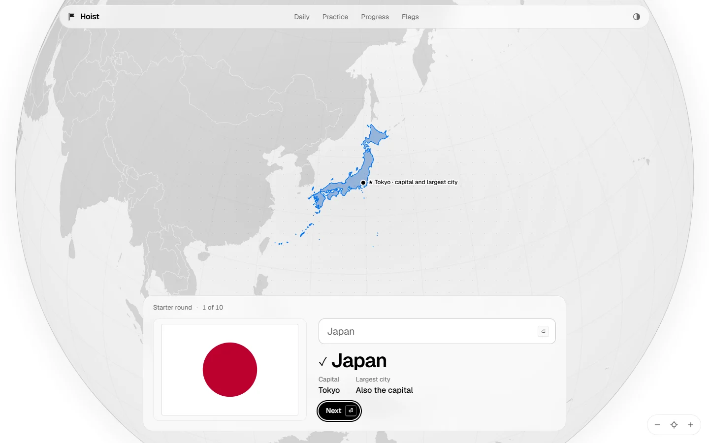
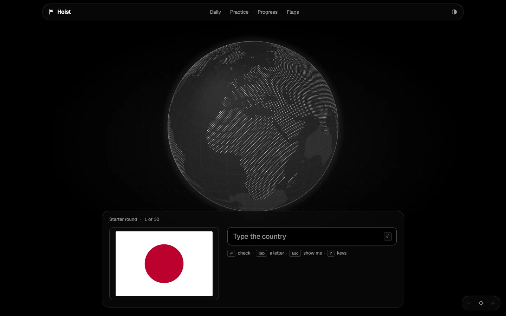
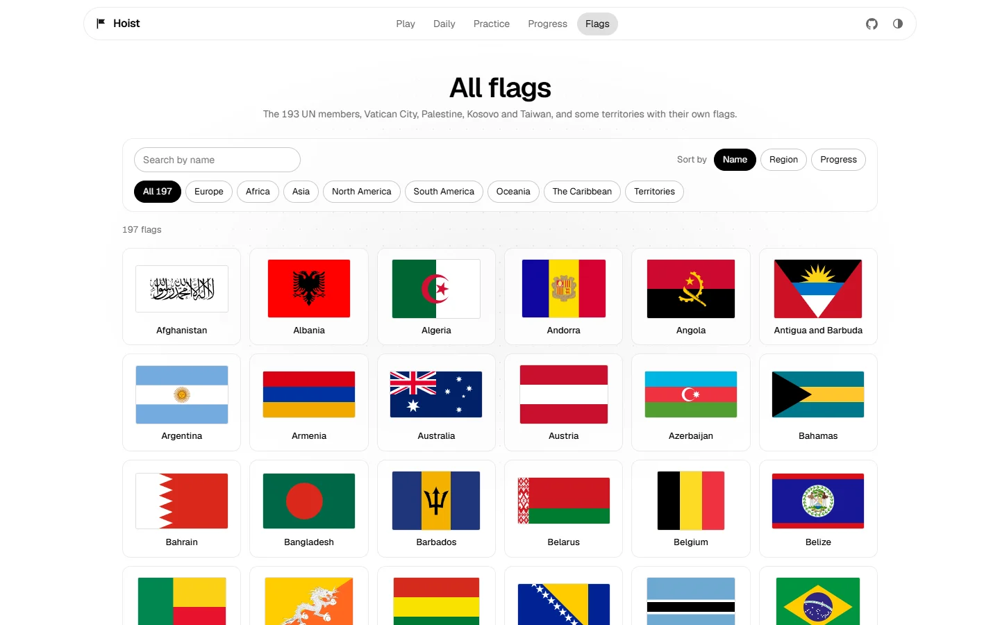
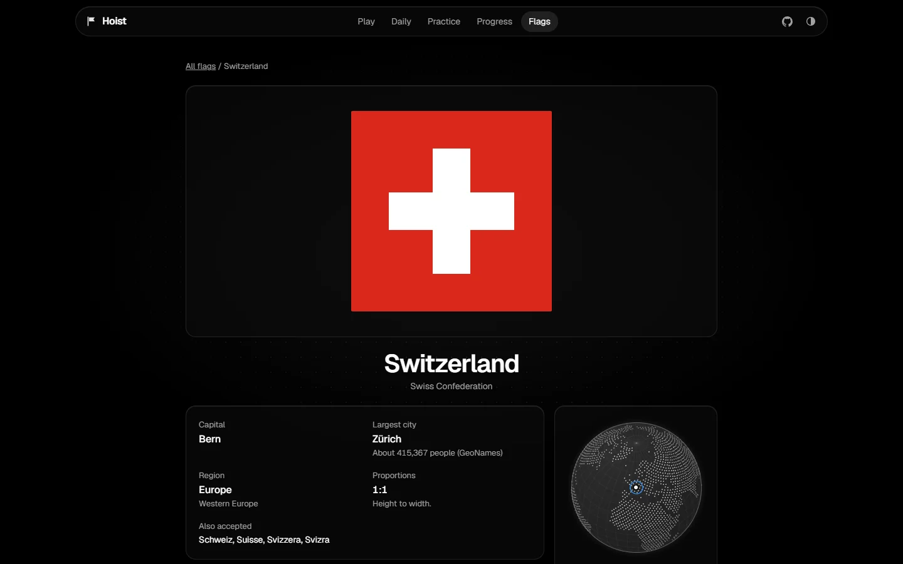
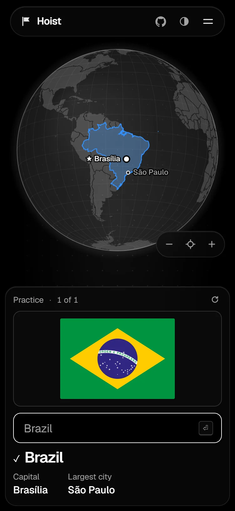

# Hoist

**Learn every flag of the world.** See a flag, type the country, and a glass
globe flies there and marks the capital and the largest city.



- **Type, don't pick.** Recalling a name sticks far better than choosing from a list.
- **Spaced repetition** (FSRS) decides what comes next, so every minute counts.
- **A glass globe** shows where each country is, its capital and its largest city.
- **Fun without noise:** a daily challenge with a share grid, streaks, speed runs,
  lookalike drills, and a mastery globe that fills in as you learn.
- **Correct flags** in true proportions, from Wikimedia Commons, checked weekly.
- **Small, fast and offline.** No account, no tracking, no ads. Works offline
  after the first visit and installs as an app.

| | |
|---|---|
|  |  |
|  |  |

## Run it

You need Node 24 and pnpm 10 (`corepack enable` sets up the pinned version).

```sh
pnpm install     # dependencies
pnpm dev         # the site on http://localhost:5173
pnpm test        # unit tests
pnpm build       # the static site in build/
pnpm preview     # serve build/ on http://localhost:4173
```

The data in `src/lib/data/`, `static/flags/` and `static/geo/` is committed,
so none of the above needs the network. To rebuild it from the sources:

```sh
pnpm data        # countries, capitals, cities, geometry and flags (downloads on first run)
pnpm audit:data  # checks on the committed data
```

More commands (end-to-end tests, Lighthouse, bundle size, screenshots) are in
[CLAUDE.md](CLAUDE.md).

## How it is made

SvelteKit and Svelte 5, prerendered to static files and served by Cloudflare.
The globe is drawn on a Canvas 2D with d3-geo, no map library. Scheduling uses
ts-fsrs. Everything you learn stays in your browser's local storage; you can
export it to a file and import it elsewhere.

- [PROMPT.md](PROMPT.md): the product brief and the source of truth
- [docs/plan.md](docs/plan.md): milestones and the steps only the owner can take
  (Cloudflare, the domain, repository settings)
- [docs/decisions.md](docs/decisions.md): every choice the brief does not cover
- [docs/research.md](docs/research.md): the facts behind the brief

## Data and credits

- Flags: [Wikimedia Commons](https://commons.wikimedia.org), each file with its
  own author and licence (listed on its flag page)
- Country names, codes and translations: [mledoze/countries](https://github.com/mledoze/countries) (ODbL)
- Capitals and largest cities: [GeoNames](https://www.geonames.org) (CC BY 4.0)
- Borders and land: [Natural Earth](https://www.naturalearthdata.com) (public domain)
- Font: [Geist](https://vercel.com/font) (SIL Open Font License)

## License

Code: MIT. Generated country data: ODbL (from mledoze/countries). See
[data/LICENSE-DATA.md](data/LICENSE-DATA.md) and the brief, section 8, for
every source and licence.
