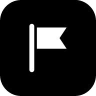
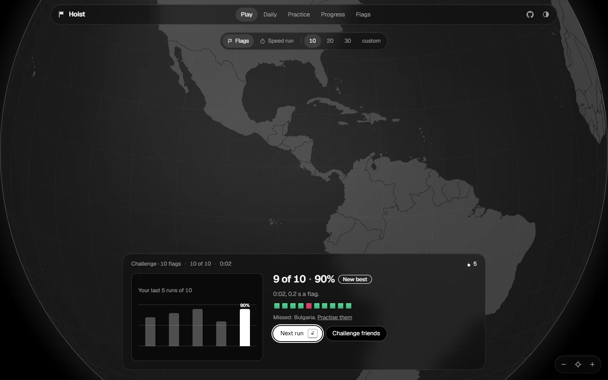

<div align="center">

<a href="https://hoist.itsanon.com"></a>

# Hoist

**Learn every flag of the world.**<br>
See a flag, type the country, and a glass globe flies there.

[](https://hoist.itsanon.com)

[](https://github.com/mrghxst/hoist/actions/workflows/ci.yml)
[](lighthouserc.cjs)
[](https://hoist.itsanon.com/flags)
[](https://hoist.itsanon.com/about)
[](#features)
<br>
[](https://svelte.dev)
[](tsconfig.json)
[](LICENSE)
[](data/LICENSE-DATA.md)

<br>


</div>

## Features

<table>
<tr>
<td width="50%" valign="top">

### ⚑ Play
Quick runs of **10, 20, 30** or any number of random flags, no repeats, no
letter hints, against the clock, like a typing test. A chart of your accuracy
shows how you improve. Or a **speed run** through all 197, or one region.

</td>
<td width="50%" valign="top">

### 🏁 Challenge your friends
Every run has its own link. Send it to a friend or a whole class: everyone
plays **the same flags**, and the results line up side by side.

</td>
</tr>
<tr>
<td valign="top">

### 📅 Daily
The same ten flags for everyone, every day. 100 points a flag, 25 if you
take the one letter allowed. Share your grid: 🟩🟩🟨🟩🟥…

</td>
<td valign="top">

### 🧠 Practice
Spaced repetition (FSRS) brings each flag back just before you would forget
it. Capitals, the reverse quiz, lookalike drills, easy mode and regions.

</td>
</tr>
<tr>
<td valign="top">

### 🌍 A glass globe
Drawn on a canvas with d3-geo: it flies to every answer, outlines the country
and its neighbours, and marks the capital and the largest city.

</td>
<td valign="top">

### ⚡ Small, fast, private
No account, no tracking, no ads. Under 50 KB of JavaScript on first load,
works offline after the first visit and installs as an app.

</td>
</tr>
</table>

<div align="center">

| | |
|:---:|:---:|
|  |  |
| **A run of 20, ready to type** | **The result, ready to share** |
|  |  |
| **Every flag, with its own page** | **Made for phones too** |

</div>

## Keys

| Key | Does |
|---|---|
| <kbd>Enter</kbd> | Check the answer, then the next flag (and the next run) |
| <kbd>Tab</kbd> | A letter: up to half the name in Practice, one in the Daily, slowly in a speed run, none in a run |
| <kbd>Esc</kbd> | Show me the answer |
| <kbd>?</kbd> | All the keys |

## Run it

You need Node 24 and pnpm 10 (`corepack enable` sets up the pinned version).

```sh
pnpm install     # dependencies
pnpm dev         # the site on http://localhost:5173
pnpm test        # unit tests
pnpm build       # the static site in build/
pnpm preview     # serve build/ on http://localhost:4173
```

The data in `src/lib/data/`, `static/flags/` and `static/geo/` is committed,
so none of the above needs the network. To rebuild it from the sources:

```sh
pnpm data        # countries, capitals, cities, geometry and flags (downloads on first run)
pnpm audit:data  # checks on the committed data
```

More commands (end-to-end tests, Lighthouse, bundle size, screenshots) are in
[CLAUDE.md](CLAUDE.md).

## How it is made

SvelteKit and Svelte 5, prerendered to static files and served by Cloudflare.
The globe is drawn on a Canvas 2D with d3-geo, no map library. Scheduling uses
ts-fsrs. Everything you learn stays in your browser's local storage; you can
export it to a file and import it elsewhere. A weekly workflow checks every
flag against Wikimedia Commons and opens a pull request when one changes.

- [PROMPT.md](PROMPT.md): the product brief
- [docs/plan.md](docs/plan.md): milestones and the steps only the owner can take
- [docs/decisions.md](docs/decisions.md): every choice the brief does not cover, and the owner's later changes
- [docs/research.md](docs/research.md): the facts behind the brief

## Data and credits

- Flags: [Wikimedia Commons](https://commons.wikimedia.org), each file with its
  own author and licence (listed on its flag page)
- Country names, codes and translations: [mledoze/countries](https://github.com/mledoze/countries) (ODbL)
- Capitals and largest cities: [GeoNames](https://www.geonames.org) (CC BY 4.0)
- Borders and land: [Natural Earth](https://www.naturalearthdata.com) (public domain)
- Font: [Geist](https://vercel.com/font) (SIL Open Font License)

## License

Code: MIT. Generated country data: ODbL (from mledoze/countries). See
[data/LICENSE-DATA.md](data/LICENSE-DATA.md) and the brief, section 8, for
every source and licence.

<div align="center">
<br>
<a href="https://hoist.itsanon.com"><b>hoist.itsanon.com</b></a>
</div>
