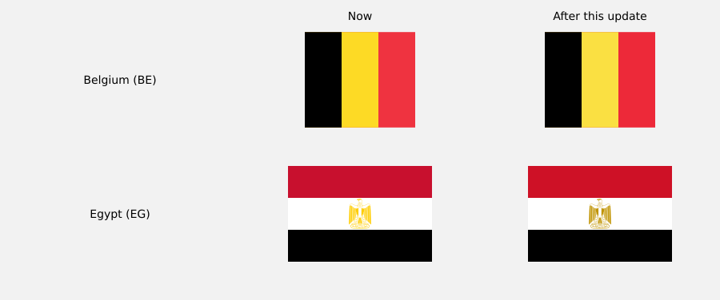

The weekly check found 2 flags that changed on Wikimedia Commons. Please look at each one before merging: a new upload is not always a better one.

| Country | Commons file | Revised | Licence | Author |
|---|---|---|---|---|
| Belgium (BE) | [Flag of Belgium.svg](https://commons.wikimedia.org/wiki/File:Flag_of_Belgium.svg) | 2026-11-07 | Public domain | Dbenbenn and others |
| Egypt (EG) | [Flag of Egypt.svg](https://commons.wikimedia.org/wiki/File:Flag_of_Egypt.svg) | 2026-11-07 | Public domain | See File history below for details. |

Made by `.github/workflows/flags.yml` with `pnpm data`. If a change is wrong, close this pull request; `data/flag-sources.json` can point the country at another Commons file.
